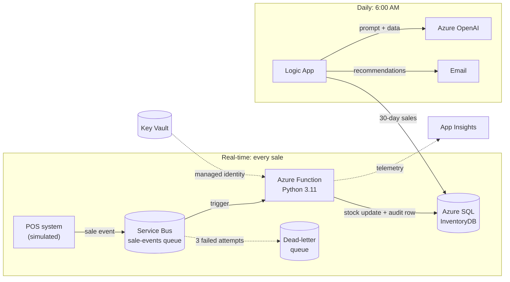

# Azure-AI-Inventory-Tracker

Jeremiah Brown | Azure Cloud Engineer | LinkedIn: https://www.linkedin.com/in/jeremiah-brown12/

**Event-driven inventory management with AI-generated restock recommendations, built on Azure with Terraform, Python and PowerShell.**


Stock counts update **within seconds of a sale**, and every morning the store owner gets an **AI-written email** saying what to reorder, how much, from which supplier and by what date. The recommendations are based on 30 days of real sales and each supplier's lead time.

---

## At a glance

| | |
|---|---|
| **Business problem** | Small retailers run out of best sellers and over-stock slow movers because ordering runs on manual counts and gut feel. |
| **What I built** | A real-time sales pipeline (Service Bus → Azure Function → Azure SQL) and a daily AI analysis (Logic App → Azure OpenAI → email). |
| **Infrastructure** | 20+ Azure resources in Terraform, with secrets in Key Vault read by managed identities |
| **Reliability** | Queue-based decoupling, transactional writes with an audit trail, automatic retry and dead-lettering |
| **Proof it works** | Test sale: Laptop stock **15 → 13**, audit row written, daily email delivered. See [How to run it](#how-to-run-it). |
| **Debugging record** | [13 real issues](docs/TROUBLESHOOTING.md), each with root cause and fix |

---

## Project Overview

Small retailers, restaurants and service businesses share an expensive problem. They either run out of the items customers want most, right when demand peaks, or they tie up cash in stock that barely moves. Both come from the same root cause: inventory decisions based on manual counts and gut feel instead of data.

A **reactive** system says *"you are running low on item A."* A **predictive** system says *"based on the last 30 days of sales, you will run out of item A in about three days. With a 3-day supplier lead time, order 25 units by Thursday."*

This project builds the predictive version.

## System Capabilities

- **Real-time stock updates:** a sale decrements stock within seconds, with no end-of-day reconciliation.
- **Guaranteed delivery:** sale events are buffered in Service Bus, so nothing is lost if the processor is restarting or deploying.
- **Automatic retry and dead-lettering:** failed events are retried 3 times, then parked for inspection instead of disappearing.
- **Full audit trail:** every stock change is recorded in `StockMovements`, written in the same transaction as the stock update.
- **Daily AI analysis:** Azure OpenAI reviews 30 days of sales against current stock, minimum levels and supplier lead times.
- **Morning email:** a prioritized restock list with quantities, suppliers and order-by dates, with **URGENT** items flagged.
- **Secure by default:** secrets live in Key Vault and are read through managed identities. Nothing secret is in code or Git.

## What gets built

```text
rg-inventory-<yourname>
├── Azure SQL Server + Database (InventoryDB)
│   ├── Table: Products
│   ├── Table: Suppliers
│   └── Table: StockMovements          → append-only audit trail
├── Service Bus Namespace (Standard)
│   └── Queue: sale-events             → buffers sale events from the POS
├── App Service Plan (B1, Linux)       → shared by the two apps below
│   ├── Function App                   → process_sale: queue trigger → SQL
│   └── Web App                        → host for the staff UI (roadmap)
├── Storage Account                    → Function runtime state
├── Azure OpenAI Account               → model deployment for recommendations
├── Logic App                          → daily 6 AM analysis + email
├── Key Vault (RBAC)                   → SQL, Service Bus and OpenAI secrets
├── Application Insights               → Function telemetry and exceptions
└── Log Analytics Workspace
```

---

## Architecture



### Architecture Flow

**Real-time path:** the point-of-sale system publishes a small JSON event to a Service Bus queue and gets an immediate acknowledgement. An Azure Function picks it up, decrements stock and writes an audit row **in one transaction**. If processing fails, Service Bus retries automatically. After 3 failures, the message moves to a dead-letter queue instead of being lost.

**Daily path:** a Logic App runs every morning. It pulls 30 days of sales from SQL, sends a compact summary to Azure OpenAI with an analyst prompt, and emails the prioritized restock list. Anything at or below minimum stock is flagged **URGENT**.

Design rationale and trade-offs are in **[docs/ARCHITECTURE.md](docs/ARCHITECTURE.md)**.

### Sample output

An example of the daily email's format (the real content depends on your sales data):

```text
URGENT
- USB-C Hub: 3 in stock (min 10). Order 25 from Backup Supplier Inc by Nov 10 (7-day lead time).
- Wireless Mouse: 8 in stock (min 10). Order 20 from Primary Supplier Co by Nov 11.

WATCH
- Laptop: 13 in stock, about 0.1 units/day sold. Roughly 130 days of cover. No order needed.
```

---

## Azure resources

| Resource | Purpose | Why this choice |
|---|---|---|
| **Service Bus** (Standard) + queue | Buffers sale events | No lost sales during restarts or deploys; built-in retry and dead-lettering |
| **Function App** (Linux, Python 3.11) | Processes each sale | Event-driven; the queue trigger scales with message volume |
| **Azure SQL Database** (Basic) | Products, Suppliers, StockMovements | Relational integrity plus transactions for stock and audit |
| **Logic App** (Consumption) | Daily scheduled AI analysis and email | Managed SQL and email connectors, visual run history, pennies per run |
| **Azure OpenAI** | Generates the restock recommendations | Managed GPT models inside the Azure trust boundary |
| **Key Vault** (RBAC mode) | SQL, Service Bus and OpenAI secrets | No secrets in code or app settings; least-privilege access |
| **App Service Plan** (B1, Linux) | Hosts the Function and the Web App | One paid plan shared by both apps |
| **Application Insights** + Log Analytics | Function telemetry and exceptions | Turned "message dead-lettered" into an exact stack trace |
| **Web App** | Host for the staff UI | Provisioned; the UI is on the roadmap |

---

## Repository structure

```text
.
├── main.tf                      # All Azure infrastructure (azurerm ~> 3.0)
├── variables.tf
├── outputs.tf
├── terraform.tfvars.example     # Copy to terraform.tfvars (git-ignored)
├── function_app/                # Azure Function: Service Bus trigger → SQL
│   ├── host.json
│   ├── requirements.txt
│   └── process_sale/
│       ├── function.json
│       └── process_sale.py
├── logic_app/
│   └── workflow.json            # Exported Logic App definition (secrets replaced with placeholders)
├── sql/
│   ├── 01_schema.sql
│   ├── 02_seed.sql
│   ├── 03_verify.sql
│   └── 04_restock_analysis.sql  # The query the Logic App runs daily
├── scripts/
│   ├── deploy_function.ps1      # Build Linux wheels, syntax check, zip, deploy
│   └── send_test_sale.ps1       # Simulates the POS by sending a sale event
└── docs/
    ├── ARCHITECTURE.md          # Design decisions, security, roadmap
    └── TROUBLESHOOTING.md       # 13 real issues: error, root cause, fix
```

---

## How to run it

1. **Deploy the infrastructure.** Copy `terraform.tfvars.example` to `terraform.tfvars`, fill in your values, then run:

   ```powershell
   terraform init
   terraform apply
   ```

2. **Send a test sale** to the Service Bus queue:

   ```powershell
   .\scripts\send_test_sale.ps1 -Name <yourname> -ProductId 1 -Quantity 2
   ```

3. **Confirm the stock decreased.** After about 30 seconds, run [`sql/03_verify.sql`](sql/03_verify.sql) in the InventoryDB Query editor. The Laptop's `CurrentStock` drops by 2, and a `SALE` row appears in `StockMovements`.

First-time setup (database schema, Function code, Logic App) is covered step by step in the next section.

---

## Deploy it yourself

### Prerequisites

- An Azure subscription with access to Azure OpenAI
- [Terraform](https://developer.hashicorp.com/terraform/install) 1.5+
- [Azure CLI](https://learn.microsoft.com/cli/azure/install-azure-cli), signed in with `az login`
- Python 3.x and pip (only for packaging the Function)

### 1. Configure

```powershell
Copy-Item terraform.tfvars.example terraform.tfvars
# Edit terraform.tfvars: set a unique `yourname`, a strong SQL password and your email.
# Your public IP for the SQL firewall:
Invoke-RestMethod https://api.ipify.org
```

> **Choosing a region:** East US often blocks new SQL servers, and App Service quota is set per region. `West US 3` worked for this build. See [issues 1–3](docs/TROUBLESHOOTING.md).

### 2. Provision the infrastructure

```powershell
terraform init
terraform plan
terraform apply
```

If `apply` fails with a `404` right after creating a resource, that's Azure's eventual consistency. Run `terraform apply` again.

### 3. Create the database schema

In the portal, open **InventoryDB → Query editor**, sign in with the SQL admin account, and run [`sql/01_schema.sql`](sql/01_schema.sql), then [`sql/02_seed.sql`](sql/02_seed.sql) (once only).

### 4. Deploy the Function

```powershell
.\scripts\deploy_function.ps1 -Name <yourname>
```

The script installs **Linux** wheels for Python 3.11 (so it works from Windows), checks the code for syntax errors, zips with `tar` (not `Compress-Archive`, whose backslash paths break on Linux), deploys, and lists the functions the host found. You should see `process_sale`.

### 5. Send a test sale

```powershell
.\scripts\send_test_sale.ps1 -Name <yourname> -ProductId 1 -Quantity 2
```

After about 30 seconds, run [`sql/03_verify.sql`](sql/03_verify.sql). The Laptop drops from **15 to 13**, and a `SALE` row appears in `StockMovements`.

### 6. Set up the daily Logic App

Open **la-restock-daily-&lt;yourname&gt; → Logic app code view** and paste [`logic_app/workflow.json`](logic_app/workflow.json). Replace the placeholders:

| Placeholder | Value |
|---|---|
| `<OPENAI_RESOURCE_NAME>` | Your Azure OpenAI endpoint (`az cognitiveservices account show ... --query properties.endpoint`) |
| `<OPENAI_API_KEY>` | `az cognitiveservices account keys list ... --query key1` |
| `<RECIPIENT_EMAIL>` | Where the report should go |
| `<SUBSCRIPTION_ID>`, `<REGION>`, `<name>` | Your values |

Then, in the designer, authorize the **SQL** connection (SQL Server Authentication, no gateway) and the **Outlook.com** connection, and click **Run Trigger**.

> The email connector must be signed in with a real Outlook mailbox. A Microsoft account registered under a Gmail address has no mailbox, and sends silently fail ([issue 12](docs/TROUBLESHOOTING.md)). It can send *to* any address.

---

## Troubleshooting highlights

All 13 issues are written up in **[docs/TROUBLESHOOTING.md](docs/TROUBLESHOOTING.md)**. The ones I learned the most from:

| Symptom | Root cause | Fix |
|---|---|---|
| Test sale dead-lettered: `MaxDeliveryCountExceeded` | Nothing showed *why*: there was no Application Insights | Added App Insights in Terraform. The stack trace showed the real error within minutes. |
| `Login failed for user ''` | The connection string used .NET `User ID`/`Password`; pyodbc's ODBC driver only understands `UID`/`PWD` | Rewrote the Key Vault secret in ODBC format and restarted the Function to clear the cached Key Vault reference |
| `Current Limit (B1 VMs): 0` while the quota page showed 0 of 30 | App Service quota is **per region** | Scripted a probe of B1 and SQL across regions and picked West US 3 |
| `pyodbc` build fails: needs Visual C++ 14.0 | pip built for Windows / Python 3.14, but the target is Linux / Python 3.11 | `pip install --platform manylinux2014_x86_64 --only-binary=:all: --python-version 3.11` |
| Logic App: every step green, but no email | The connector's account had no Outlook mailbox | Sent from a dedicated Outlook.com mailbox |

---

## Security

- **No secrets in Git.** `.gitignore` excludes `*.tfvars`, `*.tfstate` and build output. The Logic App export uses placeholders.
- **Key Vault in RBAC mode**, with **managed identities** and *Key Vault Secrets User* (read-only) for the Function and Web App.
- **SQL firewall** limited to Azure services plus one admin IP. TLS 1.2 minimum.
- **OpenAI key** hidden in Logic App run history with Secure inputs and outputs.

The production hardening plan (Entra-only SQL auth, private endpoints, least-privilege Service Bus policies, managed identity to OpenAI, remote state) is in [docs/ARCHITECTURE.md](docs/ARCHITECTURE.md#security-posture).

---

## Cost and teardown

About **$30/month** while running: App Service B1 about $13, Service Bus Standard about $10, SQL Basic about $5, and the rest (storage, Log Analytics, Logic App runs, OpenAI tokens) costs cents.

```powershell
terraform destroy
```

Key Vault and Azure OpenAI are set to **purge on destroy**, so the same names can be reused on the next deploy.

---

## What I'd build next

- **Idempotent processing:** dedupe on `sale_id`, because Service Bus is at-least-once
- **Everything as code:** move the Logic App definition into Terraform
- **CI/CD:** GitHub Actions with `fmt`, `validate` and `plan` on pull requests, and an OIDC-authenticated deploy on merge
- **Zero-secret auth:** Entra ID for SQL, Service Bus and OpenAI through managed identities, plus private endpoints
- **Staff web UI** on the provisioned Web App, and real-time low-stock alerts through Azure Monitor

---

## Skills demonstrated

`Terraform (azurerm)` · `Azure Service Bus` · `Azure Functions (Python)` · `Azure SQL / T-SQL` · `Azure Logic Apps` · `Azure OpenAI / prompt design` · `Key Vault + managed identities (RBAC)` · `Application Insights / Log Analytics` · `PowerShell automation` · `Event-driven architecture` · `Cross-platform Python packaging` · `Root-cause debugging`

---

**Jeremiah Brown**, Azure Cloud Engineer · [LinkedIn](https://www.linkedin.com/in/jeremiah-brown12/) · [GitHub](https://github.com/JeremiahBTech12)
