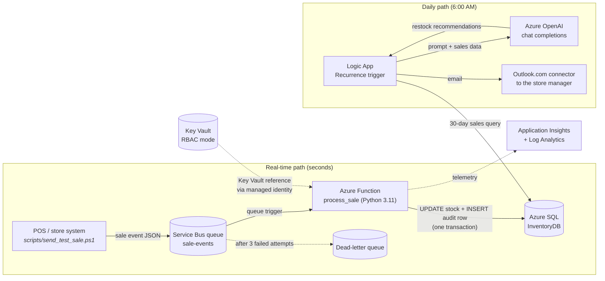

# Architecture and Design Decisions

This document explains **why** the system is built the way it is: the trade-offs I made and the alternatives I rejected. For setup steps, see the [README](../README.md). For the problems I hit along the way, see [TROUBLESHOOTING.md](TROUBLESHOOTING.md).

---

## System overview



### Event contract

The POS publishes one message per sale:

```json
{ "sale_id": "POS-20261109-104511", "product_id": 1, "quantity": 2 }
```

The POS knows nothing about the database. It only needs permission to send to one queue.

---

## Design decisions

### 1. Service Bus between the POS and the database

**Decision:** Sale events go through a Service Bus queue instead of the POS calling the database or a web API directly.

**Why:**
- **No lost sales.** If the Function is restarting, deploying or failing, messages wait in the queue. The POS gets an acknowledgement as soon as the message is stored.
- **Automatic retry with a ceiling.** `lock_duration = PT1M` and `max_delivery_count = 3` mean a failed message is retried twice more, then moved to the **dead-letter queue** instead of looping forever.
- **Loose coupling.** The POS and the inventory system can be deployed, scaled or replaced independently.

**This was tested for real:** during the build, four test sales failed (a code error, then a login error). Each was retried 3 times and dead-lettered. None were lost, and none partially updated stock. See issues 9–10 in [TROUBLESHOOTING.md](TROUBLESHOOTING.md).

**Why Standard tier:** Standard adds topics, duplicate detection and sessions, which leaves room to grow (for example, fanning sale events out to analytics). The base cost is about $10/month.

### 2. Stock update and audit row in one transaction

**Decision:** The Function decrements `Products.CurrentStock` and inserts a `StockMovements` row in a single transaction, rolling back on any error, then re-raises the exception.

**Why:** A failed sale must leave **no** partial state. Re-raising (instead of swallowing the error) is what tells Service Bus the message failed, which triggers the retry and dead-letter path. `StockMovements` is an append-only audit log, so every stock number can be traced back to the events that produced it.

**Known limitation:** Service Bus delivers *at least once*. A message that succeeds in SQL but whose completion acknowledgement is lost could be processed twice. The fix (an idempotency check on `sale_id`) is in the roadmap below.

### 3. Function App on the shared B1 plan, not Consumption

**Decision:** The Function runs on the same B1 Linux App Service plan as the Web App, with `always_on = true`.

**Why:**
- Linux Consumption (Y1) couldn't be created in the resource group (issue 2), and Microsoft is retiring Linux Consumption in favor of Flex Consumption.
- The B1 plan was already paid for, so this costs nothing extra.
- `always_on` is required on dedicated plans so the Service Bus trigger keeps listening. Without it, the host can go idle and messages stop being processed.

**Trade-off:** No scale-to-zero, and both apps share one small instance. That's fine at this scale. At production volume, I'd move the Function to **Flex Consumption** (needs `azurerm` 4.x) or an Elastic Premium plan.

### 4. Secrets in Key Vault, accessed through managed identities

**Decision:** Key Vault in **RBAC mode** (not access policies). The Function and Web App have system-assigned managed identities with the **Key Vault Secrets User** role. The Function reads the SQL connection string through a Key Vault reference:

```hcl
"SqlConnectionString" = "@Microsoft.KeyVault(VaultName=kv-inventory-...;SecretName=SqlConnectionString)"
```

**Why:**
- No secrets in app settings, code or source control.
- Least privilege: the apps can read secrets but can't change them.
- RBAC is Microsoft's recommended model, and its role assignments are managed in Terraform like any other resource.

**Operational detail I learned:** Key Vault references are cached for up to 24 hours. After rotating a secret, restart the app (or reference a specific secret version). See issue 9.

### 5. ODBC connection string format

**Decision:** The SQL secret uses ODBC keywords (`Driver=...;UID=...;PWD={...}`), not the ADO.NET format (`User ID=...;Password=...`).

**Why:** The Function connects with `pyodbc`, which passes the string to Microsoft's ODBC Driver 18. That driver silently ignores keywords it doesn't recognize, so `User ID` produced `Login failed for user ''` (issue 10). The password is wrapped in `{}` so characters like `;` can't break the string. The Logic App's SQL connector, by contrast, is .NET-based. Two clients, two formats.

### 6. Logic App for the daily AI analysis

**Decision:** A Consumption Logic App with Recurrence → SQL query → HTTP call to Azure OpenAI → email.

**Why:**
- This is a scheduled, low-frequency **integration** job. That's what Logic Apps are for: managed connectors for SQL and email, built-in retry, and a visual run history that is easy to debug and to demo.
- It costs fractions of a cent per run.
- The workflow definition is exported to [`logic_app/workflow.json`](../logic_app/workflow.json), with secrets replaced by placeholders, so it lives in source control.

**Known gap:** Terraform creates the Logic App resource, but its steps were built in the portal designer. The export is a record, not a deployment: a fresh `terraform apply` produces an empty workflow. This is the one piece of the system not yet in code. Moving it into Terraform is on the roadmap below.

**Prompt design:** The SQL query does the aggregation (units sold in the last 30 days, lead time, current and minimum stock). The model gets a compact, structured table instead of raw transactions. That keeps token usage low and the reasoning focused. The system prompt asks for days-until-stockout, an order-by date based on supplier lead time, and an **URGENT** flag at or below the minimum stock level. `temperature = 0.3` keeps day-to-day output consistent.

### 7. Observability

**Decision:** Application Insights (workspace-based, on Log Analytics) wired to the Function.

**Why:** It wasn't in the original design, and I added it after a failure I couldn't see. Without it, the only evidence was `MaxDeliveryCountExceeded` on a dead-lettered message. With it, **Monitor → Invocations** showed the exact Python exception within minutes. Lesson: observability is part of the minimum viable infrastructure, not a later add-on.

**Gap:** dead-lettered messages are still found by looking. Nothing alerts on them yet. The next step is an Azure Monitor metric alert on the queue's `DeadletteredMessages` count (greater than 0) sent to an action group, so a failed sale is noticed within minutes. It's in the roadmap below.

### 8. Region choice: West US 3

East US blocked new SQL servers (`ProvisioningDisabled`), and App Service B1 quota is set per region. I wrote a [region probe script](TROUBLESHOOTING.md#3-app-service-plan-b1-quota-is-0) that tries a throwaway B1 plan and SQL server in each candidate region, and chose West US 3 because both succeeded there.

---

## Security posture

| Area | Current state |
|---|---|
| Secrets | Key Vault (RBAC), managed identities, Key Vault references. Nothing secret is committed (`.gitignore` covers `*.tfvars` and `*.tfstate`). |
| SQL network | Allow-Azure-services rule plus a single `/32` rule for the admin's IP. Public endpoint, TLS 1.2 minimum. |
| SQL auth | SQL authentication (admin login) |
| Service Bus | Namespace-level SAS (`RootManageSharedAccessKey`) |
| OpenAI | API key in the Logic App HTTP action (Secure inputs and outputs enabled, so it's hidden in run history) |

### Production hardening I'd do next

1. **Microsoft Entra-only auth for SQL**, with the Function's managed identity as a contained database user. No SQL passwords at all.
2. **Private endpoints** for SQL, Key Vault and Service Bus, with the apps in a VNet. Remove the public SQL endpoint.
3. **Least-privilege Service Bus:** a send-only SAS policy for the POS and a listen-only one for the Function, or managed identity with the *Azure Service Bus Data Sender/Receiver* roles.
4. **Managed identity for Azure OpenAI** from the Logic App (*Cognitive Services OpenAI User* role) instead of an API key.
5. **Remote Terraform state** in an Azure Storage backend with locking. Local state holds secrets in plain text.

---

## Roadmap

- [ ] **Idempotency:** add a unique index on `StockMovements.Reference` for sales, and skip `sale_id`s that were already processed, so at-least-once delivery can never double-count.
- [ ] **Move the Logic App definition into Terraform** (`azurerm_resource_group_template_deployment` or `azapi`) so the whole stack is code.
- [ ] **Dead-letter alerting:** an `azurerm_monitor_metric_alert` on the Service Bus namespace's `DeadletteredMessages` metric, filtered to `sale-events`, with an email action group.
- [ ] **Model deployment alignment:** Terraform provisions a `gpt-5-mini` deployment, while the Logic App currently calls a `gpt-4o-mini` deployment in the same account. Pick one and manage it in Terraform. Moving to `gpt-5-mini` means switching `max_tokens` to `max_completion_tokens` and using the default temperature.
- [ ] **CI/CD:** GitHub Actions with `terraform fmt`, `validate`, `plan` on pull requests, and an OIDC-authenticated Function deploy on merge.
- [ ] **Staff web UI** on the provisioned Web App, for product management, receiving shipments, and setting minimum stock.
- [ ] **Low-stock alerts** in real time: route the Function's `LOW STOCK` log warnings to an Azure Monitor alert.
- [ ] **Upgrade to `azurerm` 4.x** and Flex Consumption for the Function.
